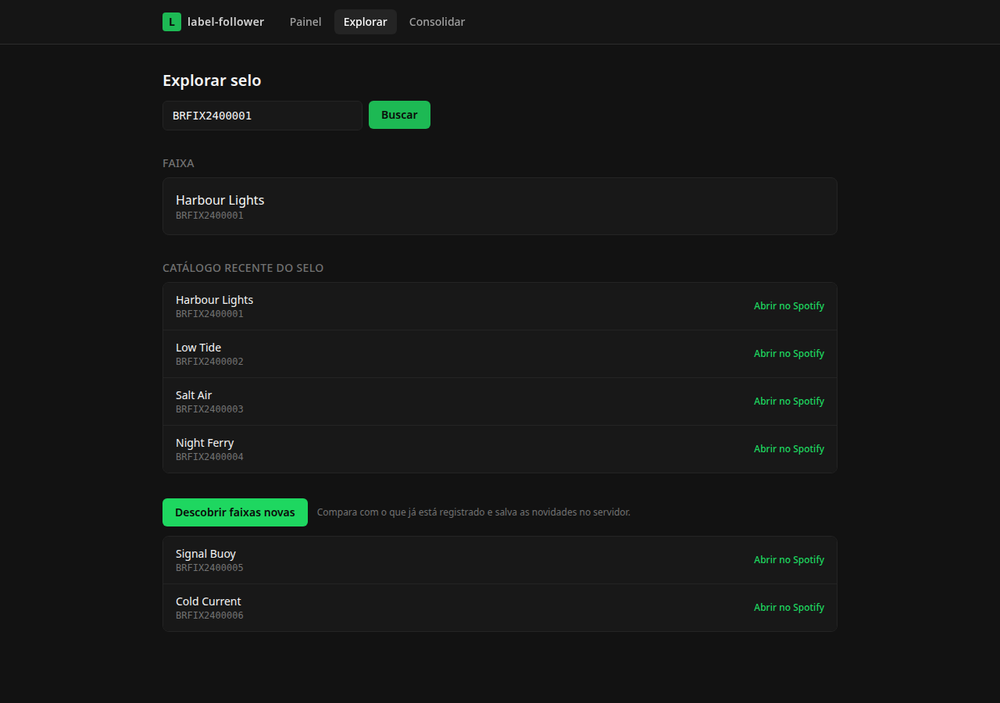

# label-follower

Keep up with the record labels you follow on Spotify: label-follower finds new tracks they've released and builds a Spotify playlist out of them automatically, instead of you checking each label's page by hand.



## Quickstart

JDK 17, Node 20+ and Docker (for MySQL), plus a Spotify app client secret — copy [`.env.example`](.env.example) to `.env` and fill it in; the [Spotify app runbook](docs/runbooks/spotify-app.md) covers the app and its redirect URI.

```bash
npm run setup
docker compose -f backend/docker-compose.yml up -d mysql
npm run be:run
npm run fe:dev
```

The API serves `http://localhost:8120` and the SPA `http://127.0.0.1:8123`. The dev server proxies `/api/*` to the API with the prefix stripped, so the browser sees one origin and the backend needs no CORS config.

### Ports

| Role | Host port | What |
|---|---|---|
| `api` | 8120 | Spring Boot backend — `http://localhost:8120` |
| `web` | 8121 | combined image: nginx serving the SPA + `/api` proxy — `http://localhost:8121` |
| `mysql` | 8122 | MySQL, host side (`docker compose port mysql 3306` reports it) |
| `frontend-dev` | 8123 | Vite dev server — `http://127.0.0.1:8123` |

Container-internal ports stay fixed (API `8080`, web `8081`, MySQL `3306`); only the host side uses the block. The committed record is [`.salgadinhos/ports.json`](.salgadinhos/ports.json).

## Checks

```bash
npm run be:check
npm run be:unit
npm run fe:typecheck
npm run fe:lint
npm run fe:test
npm run fe:build
npm run check
```

`npm run check` is the canonical all-checks command: backend detekt and the test suite, the frontend typecheck, lint and tests, then the production build. `npm run be:check` and the full backend suite need Docker for Testcontainers; `npm run be:unit` is the Docker-free lane.

## How it fits

The backend owns the Spotify integration, the label and track store, and the playlist build; the SPA is a thin browser client over its HTTP API. Their one shared contract is the wire shape, mirrored by hand in `frontend/src/api/types.ts`. Start at the [code map](docs/code-map.md) for the modules and the seams a change crosses.

## Limits

- Needs a real Spotify app client secret — Spotify rejects a fake value, so there is no dev fixture.
- The Spotify app, its redirect URI and the client secret are a manual third-party setup — see the [Spotify app runbook](docs/runbooks/spotify-app.md).
- The Consolidate flow creates playlists on the Spotify account the backend holds, so only that account can consolidate.
- The UI is dark-only, so the primary screenshot is a dark-theme capture; there is no light theme to capture.
- The repo description, topics and social preview are a one-time page setup; the social preview is a manual upload from the same screenshot — see the [repo page runbook](docs/runbooks/repo-page.md).

## Docs

- [Repository conventions](AGENTS.md) — open it when you need the repo layout, tooling and cross-cutting rules.
- [Domain glossary](CONTEXT.md) — open it when a term (label, catalog, new track) needs a precise meaning.
- [Code map](docs/code-map.md) — open it when you need the modules, seams and entry points.
- [Backend conventions](backend/AGENTS.md) — open it before changing the Kotlin service.
- [Frontend conventions](frontend/AGENTS.md) — open it before changing the SPA.
- [Backend coding standards](backend/CODING_STANDARDS.md) — open it when a Kotlin idiom is not enforced by detekt.
- [Frontend coding standards](frontend/CODING_STANDARDS.md) — open it when a React idiom is not enforced by Biome or tsc.
- [Observability contract](backend/docs/observability.md) — open it before adding or changing anything that emits telemetry.
- [Spotify app runbook](docs/runbooks/spotify-app.md) — open it when creating the Spotify app, setting the redirect URI or rotating the client secret.
- [Repo page runbook](docs/runbooks/repo-page.md) — open it when the description, topics or social preview need to follow the primary screen.

## Related projects

- [chameidor](https://github.com/luiznaac/chameidor) — the multi-module Ktor backend sibling.
- [portfolio-2](https://github.com/luiznaac/portfolio-2) — the portfolio app on the same family stack.
- [shougong](https://github.com/luiznaac/shougong) — the monorepo shape this layout follows.
- [salgadinhos](https://github.com/luiznaac/salgadinhos) — the family tooling and documentation standard.
